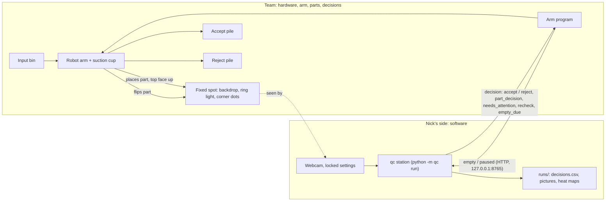

# How the QC station gets built: system outline

Version 1, 12 Nov 2026, Nick's side. This is the plan for the **whole** station. Nick's side is
responsible for the software; every other part belongs to the team (Josh and Chris). Each phase below says
who owns it, what it delivers, and how you know it's done. Add your own notes under any phase. If you
change the plan itself, say so in `notes/status.md`.

## The system in one picture

The arm program and the station talk through one small message format, which is fully specified in
`qc/handoff.py` and `docs/SETUP-GUIDE.md` step 9. That message format is the boundary between the team's
side and Nick's side.

## Phase 0. Decide what the station must do (team)

Before building, write these down in `notes/status.md`. Every later choice depends on them.

1. **The parts:**
   - which shapes and sizes;
   - which faces matter;
   - what colour and finish they are (matte or shiny, dark or light).

   Dark parts need a light grey backdrop. Shiny flat parts need diffuse light instead of a ring light.
2. **Which defects count:** chips, scratches, dents, stains, missing features. Also the **smallest one that
   must be caught**, in millimetres. That sets the camera height.
3. **The business numbers.** The software uses these placeholders until you decide:

   | Number | Placeholder | Source |
   |---|---|---|
   | Good parts scrapped (target) | 1 % | Nick's starting point, to confirm |
   | Expected share of damaged parts | 5 % | placeholder |
   | Most good parts you may scrap | 2 % | placeholder |
   | Cost of shipping a damaged part, against scrapping a good one | 10 : 1 | placeholder |

4. **Throughput:** parts per minute. The software's time per face has to be measured on your computer
   (phase 5). The arm's moves are usually the slower part.
5. **The computer:** a laptop or desktop first. A Raspberry Pi 5 (4 GB or more) is possible later, but its
   speed is not measured yet.

**Done when:** all five are written down, with the numbers as ranges if you're not sure yet.

## Phase 1. Install and try the software without hardware (team runs it; Nick's side supports)

- Follow `docs/SETUP-GUIDE.md` step 1 on the computer that will run the station.
- Run the whole station on computer-generated parts:
  - `python -m qc run --simulate --parts 20`
  - `python -m pytest`

**Done when:** the simulated run prints 20 decisions, and the tests pass. If not, write a question file.

## Phase 2. Build the scene (team)

Setup guide steps 2-5. Main points:

| Item | Requirement | Why |
|---|---|---|
| Webcam | manual focus and manual exposure (Logitech C920 class); rigid mount pointing straight down; cable taped | any movement looks like a defect or a changed backdrop |
| Height | the largest part fills a third to half of the picture's width; one height per size class if sizes differ a lot | more pixels on small defects |
| Light | ring light around the lens, one fixed brightness, near full power; blinds closed | light changes look like defects |
| Backdrop | matte black felt or flocked paper (light grey for dark parts) | the program separates part from backdrop by comparing with the empty spot |
| Corner dots | two small white dots in two picture corners | the program notices a bumped camera |
| Mirrors | removed or covered for now | mirror views come later |
| **The spot (team's design)** | a marked area or a shallow locating nest. The arm must place within the picture with some margin. Angle may vary; the software straightens it. | parts too near the picture's edge are refused |

**Done when:**
- `python -m qc camera-setup` and `python -m qc camera-check` pass (steps 6-7);
- the lens calibration (`make-card`, then `calibrate-camera`, step 8) passes its error check;
- `python -m qc collect-empty` says `"ok": true`.

If a check fails, send `runs/camera_check_*.json` in a question file.

## Phase 3. Connect the arm (team owns the arm program; Nick's side owns the station's half)

The arm program is yours. It must follow this sequence (the example in `tools/arm_client_example.py` holds
the exact Python to copy):

1. **Session start:** spot empty, arm out of view → send `empty`. If it's refused, something is in view:
   clear it and send again.
2. **For each part:**
   1. pick it from the input bin;
   2. place it on the spot, top face up;
   3. move the arm **out of the camera's view**;
   4. wait for the part to stop;
   5. send `paused` with a new `part_id`, the `shape` and `face: "top"`;
   6. if the reply says `recheck: true`, wait a moment and send `paused` again for the same part and face
      (the example tries twice);
   7. flip the part, move out of view, and send `paused` with the same `part_id` and `face: "bottom"`;
   8. put the part on the **accept pile only if the last reply says `"part_decision": "accept"`**.
      Everything else goes to reject, and a reply with `needs_attention: true` also flags the part for a
      person (light, sound or a separate tray: your choice).
3. **Whenever a reply says `empty_due: true`:** clear the spot and send `empty` before the next part.
4. **If the station doesn't answer (crashed, not started):** stop sorting. Never default to accept.
5. **Arm safety** (speed limits, stops, guards, the work area) is entirely the team's, under your lab's
   rules.

**Done when:** 20 cycles with ordinary parts run end to end. Every reply should be in the station's
`runs/<date-time>/decisions.csv`, and no part should reach the accept pile without `part_decision: accept`.
At this stage every part is rejected, because no model is trained yet. That's expected.

## Phase 4. Collect the pictures (team)

| Set | How many | Rules |
|---|---|---|
| Good parts | **50-100 different parts per shape per face** | each photographed once (`collect-good`; 20 are held back automatically). The same part ten times teaches that part, not "good parts". |
| Damaged parts | **10-20 per shape per face**, on the damaged face | `collect-damaged`; used to check the accept/reject line |
| **Held-back test set (keep separate; never train on it)** | as many as you can, mixed good and damaged, with damage graded clear / mild / barely visible | the only honest measure of the real station (phase 6) |

Keep a spreadsheet of which physical part is which `part_id`, with its true label. Pictures stay out of git.

**Done when:** each shape and face has its good and damaged sets, and the test set is labelled and put
aside.

## Phase 5. Train and set the accept/reject line (software is Nick's; running it and judging the result is the team's)

1. Train with `python -m qc train`. Read every `CHECK:` line (a training picture that looks unlike the
   others) and every `WARNING:` line. Delete wrong pictures and train again.
2. Run `python -m qc learning-curve --shape <shape> --face <face>`. It says whether there are enough good
   pictures (`Enough at N` or `Not settled ... collect more`).
3. Run `python -m qc calibrate-threshold` after adding damaged parts. The line comes from the data; never
   type in a number.
4. Time one face on your computer. The station logs it; compare it with phase 0's throughput.

**Done when:** the learning curve has settled for every shape and face, and the held-out good parts
scrapped is at or under your phase-0 target.

## Phase 6. Prove it on the real station (team, with Nick's side helping to read the results)

Run the held-back test set through the real station, with the arm doing everything, as a blind test. Then
report:

| Measure | What it tells you |
|---|---|
| Damaged parts accepted (escapes), by grade | the smallest defect the station really catches |
| Good parts scrapped | against the phase-0 target |
| `needs_attention` rate, and its reasons | how often a person is needed |
| Recheck rate | how settled the arm leaves parts |
| Seconds per part | against the throughput target |

Report each rate with its 95 % range. With only 50 parts, a 2 % rate has a wide range (roughly 0.4-10 %), and
the range says how sure the number is. The software's reports use the Wilson interval for this.

The setup guide calls a few settings "chosen": stillness limits, the light level, and the camera height
within its range. These are worth a small **designed experiment (DOE)** on the real station: a few runs
varying two or three settings at once, measuring the table above. Ask in `questions/` and Nick's side will
help design it.

**Done when:** the table is filled in with ranges and compared with phase 0.

## Phase 7. Run it day to day (team)

- **Start of every session:**
  1. light on and warm;
  2. `python -m qc camera-check`;
  3. spot empty, then `empty`.
- **While running:** respond to `empty_due` and read `needs_attention` reasons. A burst of the same reason
  usually means the scene changed (a bumped camera, room light).
- **New part type, changed backdrop, light or camera:** collect and train again for what changed. Send
  `empty` with `"force": true` only after a deliberate change.
- Keep the `runs/` logs. They're the evidence for the course reports.

## Phase 8. Later

| Item | Owner | Waits for |
|---|---|---|
| **Mirror views** of the parts' sides | Nick's side (software) | the team fixing the mirrors' positions and sending pictures |
| **Raspberry Pi** as the station's computer | team (hardware), Nick's side (timing, fixes) | phase 6 working on a laptop |
| Several size classes or camera heights | both | phase 0's part list |

## Open decisions (team)

1. The four business numbers in phase 0 (scrap target, expected defect rate, scrap cap, cost ratio).
2. The smallest defect that must be caught, in mm.
3. The parts in scope: shapes, colours, finishes.
4. The spot's design, and how the arm signals a flagged part.
5. The computer the station runs on.

## Known limits of the software today (from `docs/build-reports/2026-11-12-audit-fixes.md`)

- It has been tested on computer-generated pictures only. Real results are unknown until phases 5-6.
- On the harder simulated scene it caught:
  - about 94 % of normal-size damage;
  - 57 % of subtle damage;
  - 17 % of faint damage.

  It scrapped 2.5 % of good parts, against the 1 % target. More held-out good pictures is the fix, not a
  typed-in margin.
- There are no mirror views yet.
